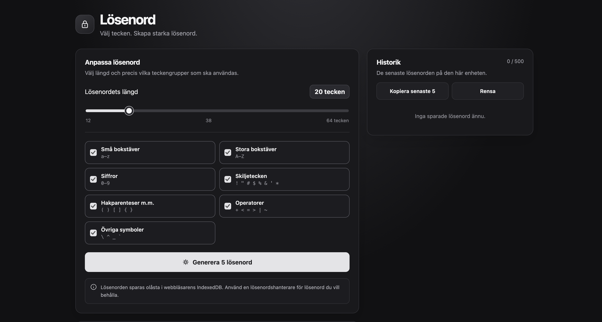
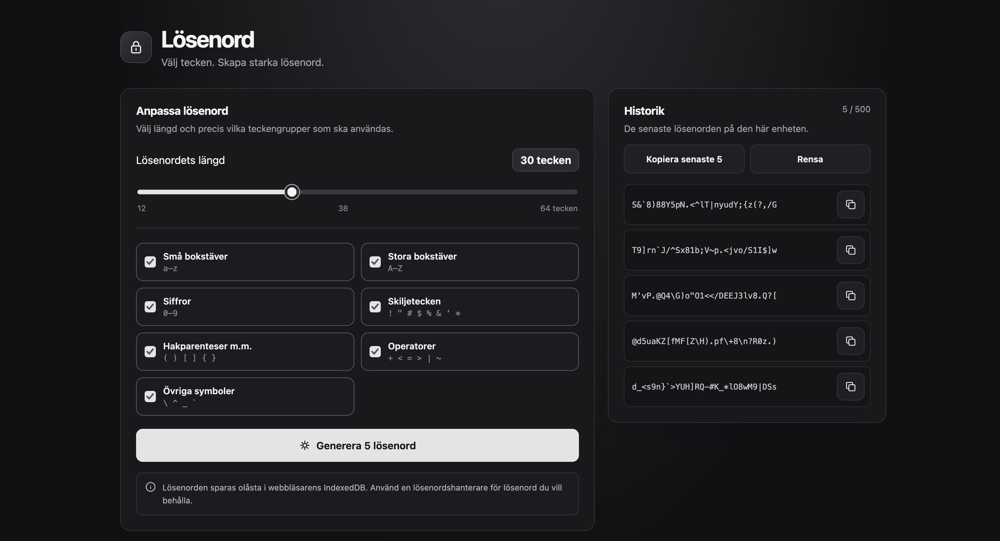
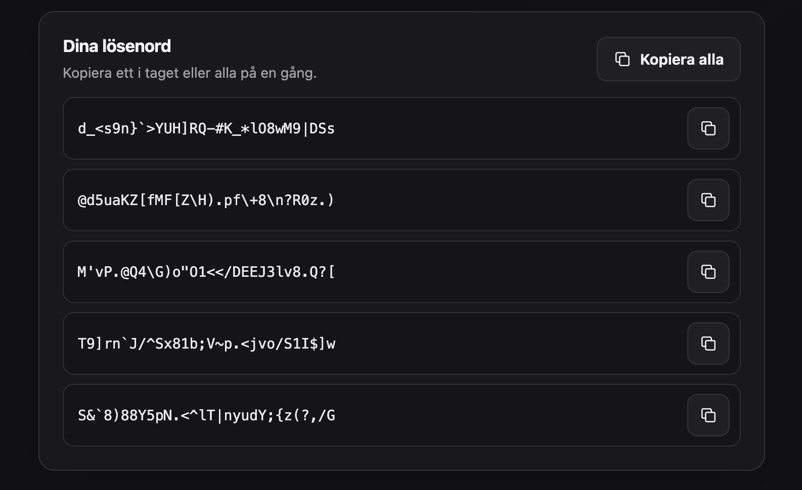

# Lösenords Generator
Med `crypto.getRandomValues()` och rejection sampling för att undvika modulo-bias. En responsiv lösenordsgenerator som skapar fem lösenord åt gången. Den låter användaren välja längd och vilka teckengrupper som ska ingå, och sparar historik lokalt i webbläsarens IndexedDB.

Appen genererar lösenord – den hash:ar eller krypterar dem inte. Historiken innehåller därför lösenorden i klartext.

## Funktioner

- Genererar **5 lösenord per omgång**.
- Valbar längd från **12 till 64 tecken**, med reglage.
- Valbara teckengrupper:
  - gemener
  - versaler
  - siffror
  - skiljetecken
  - hakparenteser och andra klamrar
  - operatorer
  - övriga symboler
- Ser till att varje vald teckengrupp finns representerad minst en gång i varje genererat lösenord.
- Skapar slumpvärden med `crypto.getRandomValues()` och rejection sampling för att undvika modulo-bias.
- Sparar historik i IndexedDB och behåller högst **500 unika lösenord**.
- Har separata kopieringsknappar för varje lösenord.
- Kan kopiera de fem lösenord som just skapats, eller de fem senaste i historiken, med ett lösenord per rad.
- Lösenord i både resultatlistan och historiken kan markeras genom att klicka på dem.
- Visar toast-notiser vid åtgärder, exempelvis kopiering.
- Har grått tema och en layout utformad för mobil och bredare skärmar.

## Kom igång

Projektet är en klientbaserad webbsida och kräver ingen byggprocess eller serverdel.

1. Spara projektkoden som `index.html`.
2. Öppna filen i en modern webbläsare.

För lokal utveckling kan du också servera filen via en lokal utvecklingsserver. Det kan behövas för webbläsarfunktioner som Clipboard API, vilka normalt kräver en säker kontext, till exempel HTTPS eller `localhost`.

## Så fungerar lösenordsgenereringen

### Teckengrupper och längd

Användaren väljer lösenordets längd och de teckengrupper som ska användas. Varje lösenord byggs från den sammanlagda mängden tillåtna tecken.

För att uppfylla kravet att varje vald grupp ska finnas med minst en gång väljs först ett tecken ur varje aktiv grupp. Återstående positioner fylls med slumpmässigt valda tecken ur den sammanlagda mängden. Därefter blandas lösenordet så att grupptecknen inte alltid hamnar på förutsägbara positioner.

Längden måste vara tillräcklig för antalet valda grupper. Gränssnittet bör därför hindra en kombination där det finns fler aktiva grupper än tillgängliga teckenpositioner.

### Säker slumpmässighet

Generatorn använder Web Crypto API:s `crypto.getRandomValues()` i stället för `Math.random()`. För att välja ett tecken används rejection sampling: slumpvärden som skulle ge en sned fördelning när de omvandlas till ett index förkastas och hämtas på nytt.

Detta minskar modulo-bias, som annars kan uppstå när ett slumpvärde reduceras med modulo till ett intervall vars storlek inte jämnt delar upp värdets möjliga intervall.

Webbläsaren behöver stödja `crypto.getRandomValues()`. Om API:t saknas bör appen inte falla tillbaka till en svagare slumptalskälla för lösenordsgenerering.

## Historik och IndexedDB

Historiken sparas i webbläsarens IndexedDB. Den är knuten till appens webbplatsursprung, vilket innebär att den inte automatiskt delas mellan olika webbläsare eller enheter. Om webbplatsens lagringsdata rensas kan historiken försvinna.

Historiken innehåller lösenorden i **klartext**. IndexedDB är lokal webbläsarlagring, inte en säker lösenordsdatabas eller ett krypterat valv. Andra personer eller program med åtkomst till samma användarprofil kan i vissa situationer komma åt webbläsardata. Spara därför inte lösenord i historiken om enheten eller webbläsarprofilen delas eller inte är betrodd.

Appen håller historiken till högst 500 unika lösenord. När ett lösenord redan finns i historiken ska det inte läggas till som en ny dubblett. När gränsen överskrids tas de äldsta posterna bort så att de 500 senaste unika posterna behålls.

## Kopiering och markering

Varje lösenord har en egen kopieringsknapp. Det finns också funktioner för att kopiera:

- alla fem lösenorden från den senaste genereringen
- de fem senaste lösenorden från historiken, ett per rad

Kopiering använder webbläsarens urklippsfunktioner. Tillgänglighet kan bero på webbläsarstöd och säker kontext. Appen visar en toast-notis när en åtgärd lyckas eller misslyckas.

Lösenordstexten i både den nya listan och historiken kan markeras genom att klicka på den. Markeringen är visuell och ska inte ändra själva lösenordet.

## Tillgänglighet och responsivitet

Gränssnittet är utformat med mobil användning och tillgänglighet i åtanke. Det omfattar bland annat tydliga kontroller, läsbar kontrast i det grå temat och responsiv layout.

Att utforma för WCAG innebär inte automatiskt att appen är verifierat WCAG-kompatibel. En sådan bedömning kräver testning av den färdiga sidan, bland annat med tangentbord, skärmläsare, förstoring och kontrastverktyg. Kontrollera även att fokusmarkeringar och toast-notiser fungerar begripligt för hjälpmedel.

## Teknik

- Web Crypto API: `crypto.getRandomValues()`
- IndexedDB för lokal historik
- Clipboard API för kopiering

All funktionalitet körs i webbläsaren; appen behöver ingen serverdel för lösenordsgenerering eller historik.

## Säkerhetsbegränsningar

- Lösenord som sparas i historiken lagras i klartext i webbläsarens IndexedDB.
- Appen hashar, krypterar eller synkroniserar inte lösenorden.
- Rensning av webbplatsdata kan ta bort historiken.
- Enhetens säkerhet, webbläsarprofilens åtkomstskydd och eventuella webbläsartillägg ligger utanför appens kontroll.
- Använd inte appen på en enhet du inte litar på, och spara inte känsliga lösenord i historiken på en delad enhet.
